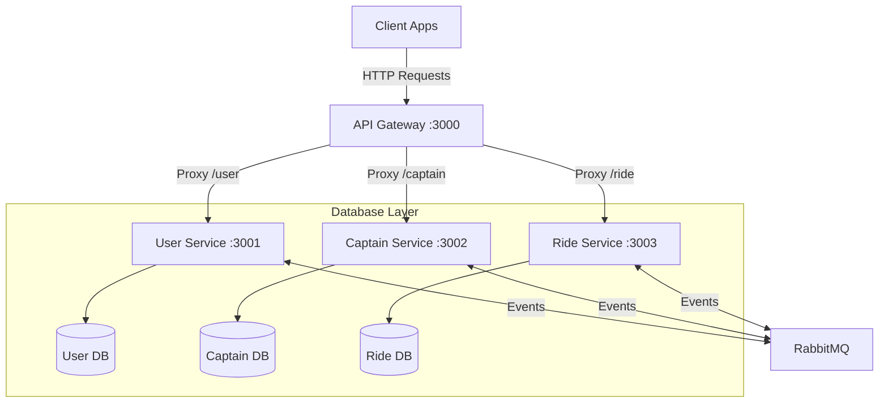

# Uber-Microservice
A Node.js and Express-based microservices backend clone of a ride-sharing application (like Uber or Ola). This repository demonstrates how to architect a backend system using a modular microservices approach, complete with an API Gateway and decoupled service domains.
---
## 🏗️ Architecture Overview
The application is structured into four primary components: an API Gateway and three distinct microservices. Each microservice runs on its own port and manages its own business logic and database connections.

### Component Details
1.  **API Gateway (Port 3000):** Acts as the single entry point. It receives all client traffic and proxies requests to the appropriate internal microservices using `express-http-proxy`.
2.  **User Service (Port 3001):** Responsible for riders/passengers. Manages user registration, authentication, sessions, profiles, and database operations.
3.  **Captain Service (Port 3002):** Responsible for drivers ("captains"). Manages driver registration, authentication, active status, and real-time location.
4.  **Ride Service (Port 3003):** Responsible for coordinating rides. Handles trip booking, passenger-to-driver matchmaking, and updates on trip states.
---
## 🛠️ Technology Stack
*   **Runtime:** [Node.js](https://nodejs.org/)
*   **Web Framework:** [Express.js](https://expressjs.com/)
*   **Gateway Proxying:** `express-http-proxy`
*   **Message Broker:** [RabbitMQ](https://www.rabbitmq.com/) (using `amqplib` for asynchronous service events)
*   **Configuration:** `dotenv`
*   **Database Integration:** MongoDB (via Mongoose ORM)
---
## 📁 Repository Structure
```text
Uber-Microservice/
├── gateway/          # API Gateway (Express routing proxy)
├── user/             # User microservice (Rider auth & profiles)
├── captain/          # Captain microservice (Driver auth & details)
├── ride/             # Ride microservice (Booking & matchmaking)
└── README.md
```
---
## 🚀 Getting Started
### Prerequisites
*   [Node.js](https://nodejs.org/) (v16+ recommended)
*   [MongoDB](https://www.mongodb.com/) (running instance)
*   [RabbitMQ](https://www.rabbitmq.com/) (running instance or via Docker)
*   npm or yarn
### Installation
Clone the repository and install dependencies in each service directory:
```bash
# Clone the repository
git clone https://github.com/Luckychh13/Uber-Microservice.git
cd Uber-Microservice
# Install dependencies for all services
for dir in gateway user captain ride; do
  echo "Installing dependencies for $dir..."
  cd $dir && npm install && cd ..
done
```
### Environment Configuration
Create a `.env` file in the root of the `user`, `captain`, and `ride` microservices directories.
Example `.env` configuration:
```env
PORT=3001 # (3001 for user, 3002 for captain, 3003 for ride)
MONGO_URI=mongodb://localhost:27017/uber_service
JWT_SECRET=your_jwt_secret_key
RABBIT_URL=amqp://localhost # RabbitMQ connection string (referenced as rabbitUrl in code)
```
### Running the Services
To start the entire application, you will need to run each service individually in a separate terminal window:
```bash
# Start Gateway
cd gateway && npm start
# Start User Service
cd user && npm start
# Start Captain Service
cd captain && npm start
# Start Ride Service
cd ride && npm start
```
---
## 🔗 Route Mappings (API Gateway)
The API Gateway routes traffic transparently based on URL path prefixes:
|
 Client Request Path 
|
 Proxied Service 
|
 Target Internal URL 
|
|
:---
|
:---
|
:---
|
|
`http://localhost:3000/user/*`
|
 User Service 
|
`http://localhost:3001/*`
|
|
`http://localhost:3000/captain/*`
|
 Captain Service 
|
`http://localhost:3002/*`
|
|
`http://localhost:3000/ride/*`
|
 Ride Service 
|
`http://localhost:3003/*`
|
